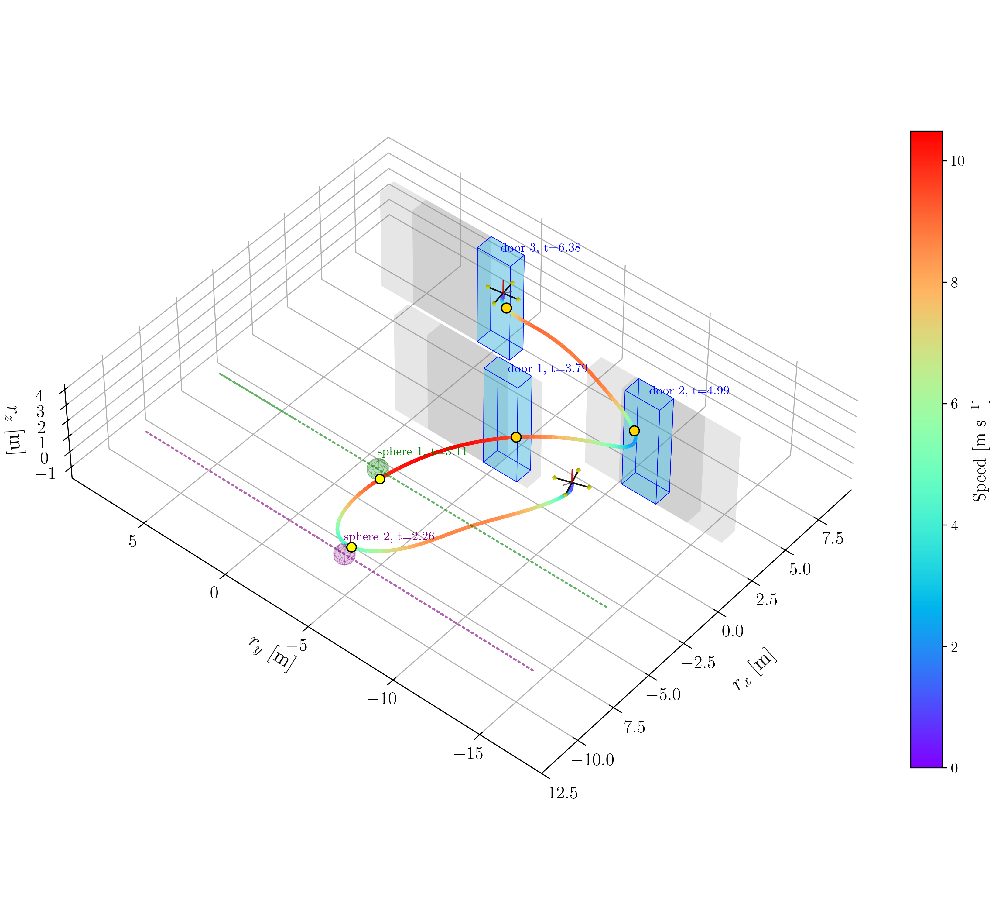
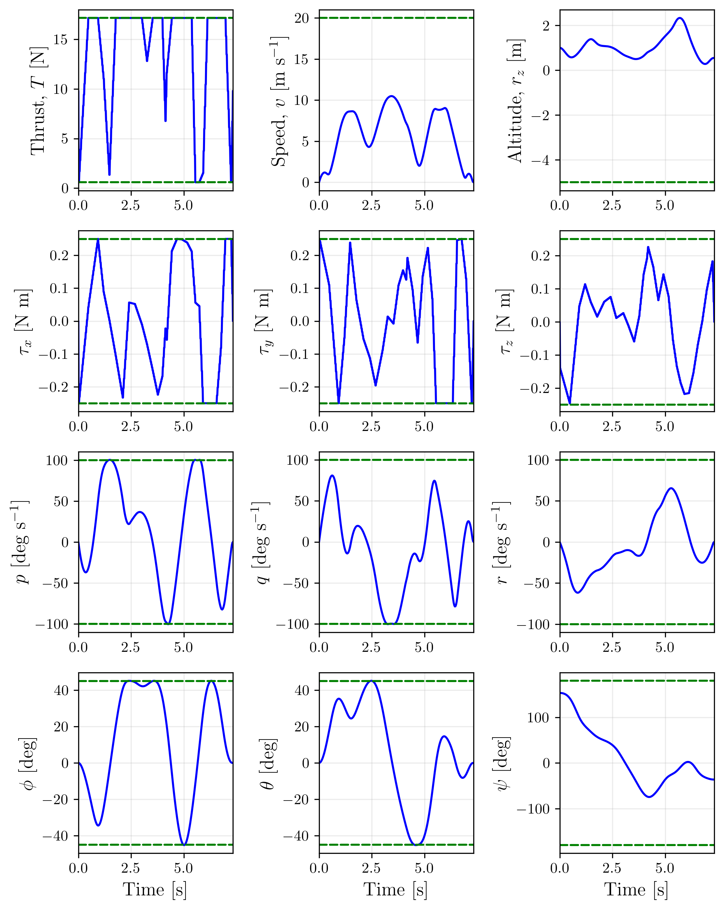
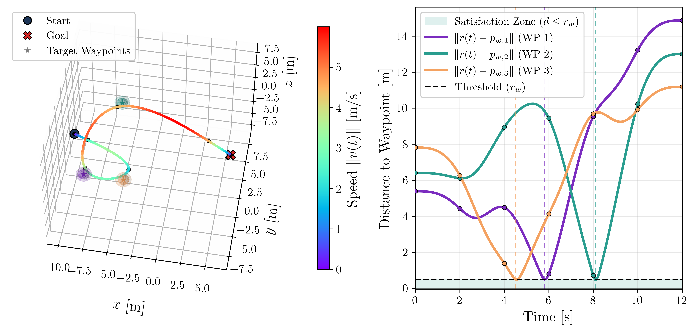

# CT-STL

Trajectory optimization with continuous-time Signal Temporal Logic (STL) constraints, using sequential convex programming, [ICORE](https://github.com/sametuzun781/ICORE), and fast RK4 discretization.

## Quick start

Use Python 3.12 and a C/C++ compiler (macOS: `xcode-select --install`).

```bash
git clone https://github.com/sametuzun781/TrajOpt_CT-STL.git
cd TrajOpt_CT-STL
python3.12 -m venv .venv
source .venv/bin/activate
python -m pip install -r requirements-comparators.txt
python -m ipykernel install --user --name ct-stl-icore
```

Open a `run_*.ipynb` notebook with the `ct-stl-icore` kernel, or run:

```bash
python run_example.py --backend icore_cpp --audit
```

Native libraries build on first use. Notebook plots require LaTeX.

## Options

```python
SOLVER_BACKEND = "icore_cpp"  # cvxpy_qoco, qoco_native, jax_icore, icore_c, icore_cpp
DYNAMICS_AD = "forward"      # forward or reverse
DISCRETIZATION_MODE = "fast" # fast, jax, reference, or native
```

`fast` selects certified native CPU discretization for supported Quadrotor models,
falling back to JAX otherwise. `reference` uses the original RK4 implementation;
`native` requires a supported model. `DYNAMICS_AD` applies to JAX/reference;
native derivatives are analytic.

#### Main Example

**Task:** Eventually visit two dynamic waypoints and reach the end zone while always avoiding dynamic obstacles.


  


---

#### Demonstrative Examples

##### Problem 1: Always avoid obstacles


##### Problem 2: Eventually visit three waypoints



##### Problem 3: Until visiting the charging station, the speed must remain below the threshold

- **Case 1**


- **Case 2**

  
  

