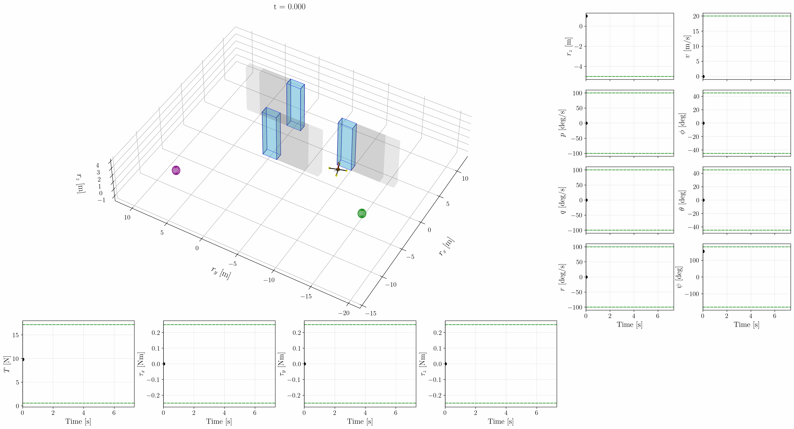
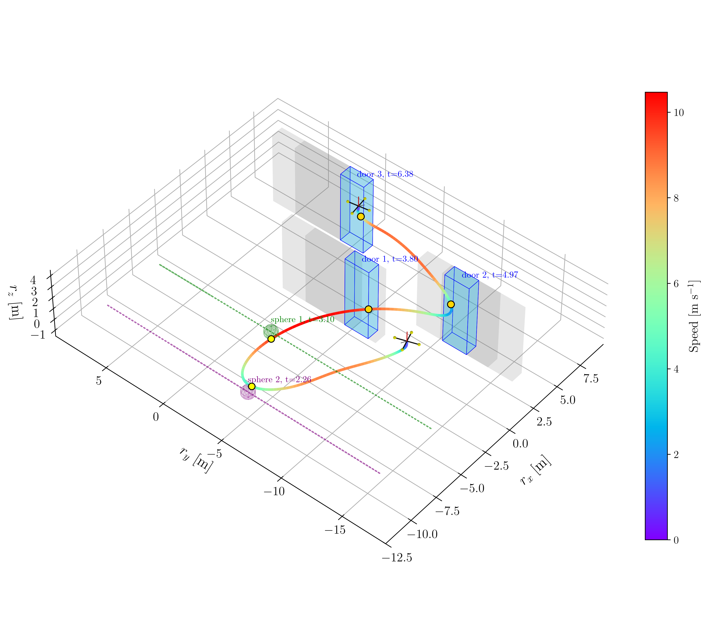
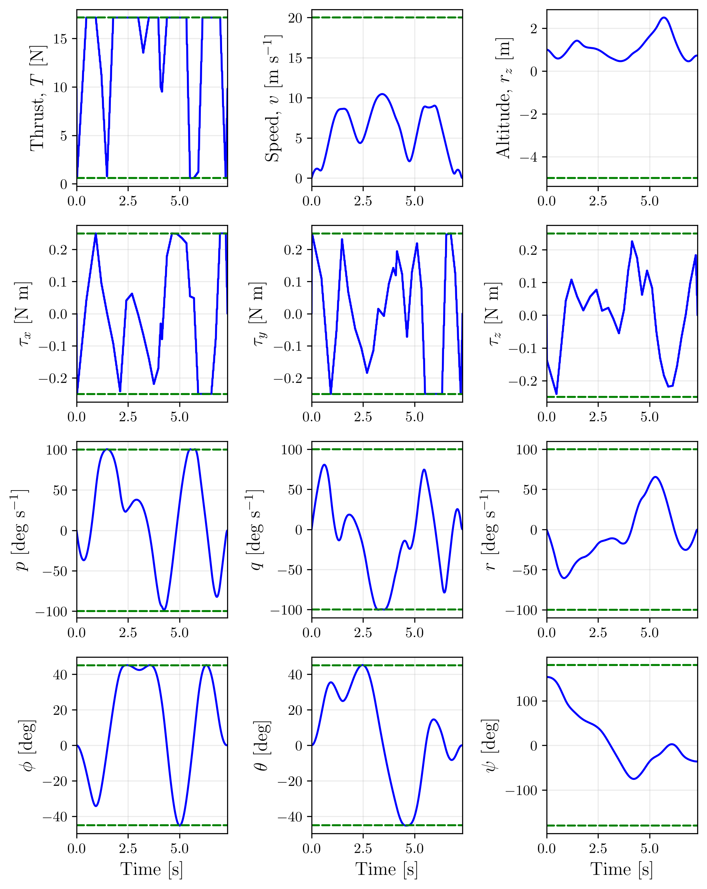
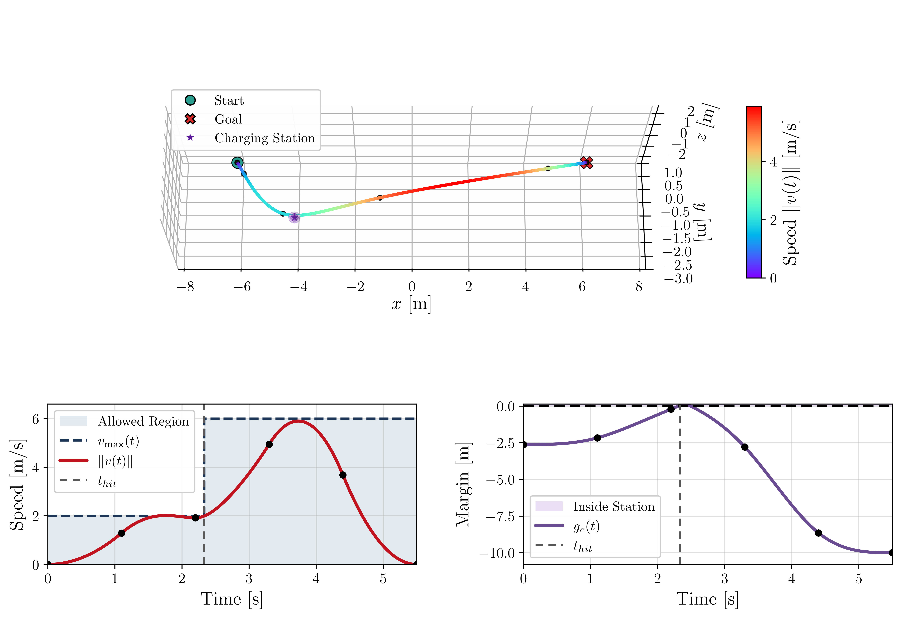
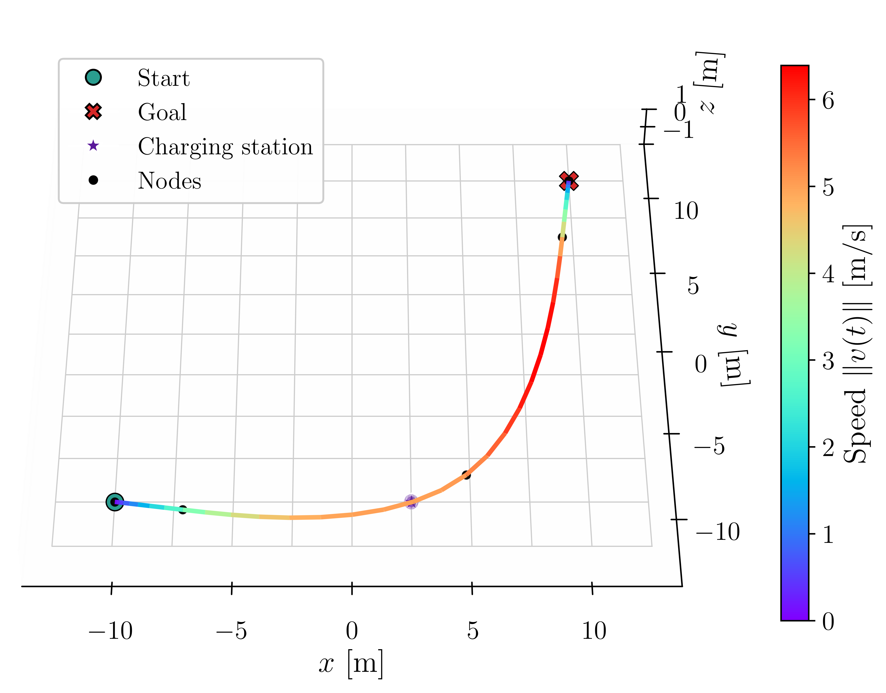
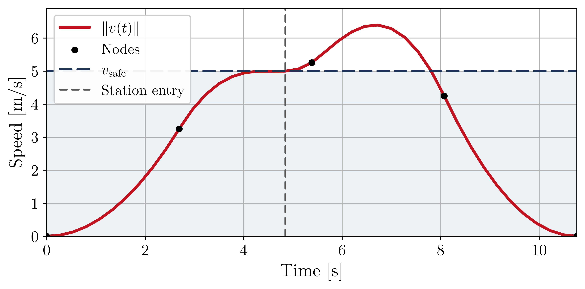
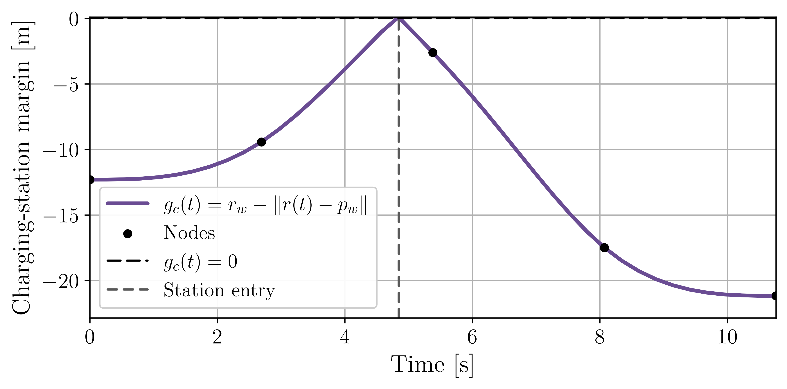

# CT-STL

Trajectory optimization with continuous-time Signal Temporal Logic (STL) constraints, using sequential convex programming, [ICORE](https://github.com/sametuzun781/ICORE), and fast RK4 discretization.

## Quick start

Use Python 3.12 and a C/C++ compiler (macOS: `xcode-select --install`).

```bash
git clone https://github.com/sametuzun781/TrajOpt_CT-STL.git
cd TrajOpt_CT-STL
python3.12 -m venv .venv312
source .venv312/bin/activate
python -m pip install -r requirements-comparators.txt
python tools/install_icore.py
python -m ipykernel install --user --name ct-stl-icore --display-name "CT-STL ICORE (Python 3.12)"
```

Open a `run_*.ipynb` notebook and select **CT-STL ICORE (Python 3.12)**,
or select this repository's `.venv312/bin/python` in VS Code. Restarting an old
kernel does not switch its Python environment. Alternatively, run:

```bash
python run_example.py --backend icore_cpp --audit
```

ICORE is installed separately from commit `a63ebffb005725a02d2c3e4247fb73aec453e590`.
The installer verifies the source checksum and the installed Solver/ChainQP API;
benchmark and HPIPM files are omitted. Internet is needed for the first source
installation. Native libraries build on first use. Notebook plots require LaTeX.

For numerical checks, install `pytest` and run `python -m pytest tests -q`.
The notebook-cleanliness check assumes saved outputs have been cleared; use
`-k 'not test_notebooks_are_clean'` when retaining local notebook outputs.

## Options

```python
SOLVER_BACKEND = "icore_cpp"  # cvxpy_qoco, qoco_native, jax_icore, icore_c, icore_cpp
DYNAMICS_AD = "forward"      # forward or reverse
DISCRETIZATION_MODE = "fast" # fast, jax, reference, or native
```

`fast` selects certified native CPU discretization for the Quadrotor and double-integrator models,
falling back to JAX otherwise. `reference` uses the original RK4 implementation;
`native` requires a supported model. `DYNAMICS_AD` applies to JAX/reference;
native derivatives are analytic.

## Code layout

- `ctstl/`: SCP, STL, discretization, and shared utilities.
- `solvers/`: adapters for the separately installed ICORE runtime and QOCO.
- `model/`, `native_discretization/`: example models and native CPU integration.
- `tests/`: numerical checks and benchmarks.
- `tools/install_icore.py`: install the pinned ICORE dependency in the active environment.
- `run_*.ipynb`, `run_example.py`: notebook and command-line entry points.

#### Main Example

**Task:** Eventually visit two dynamic waypoints and reach the end zone while always avoiding dynamic obstacles.



  


---

#### Demonstrative Examples

##### Problem 1: Always avoid obstacles


##### Problem 2: Eventually visit three waypoints


##### Problem 3: Until visiting the charging station, the speed must remain below the threshold

- **Case 1**



- **Case 2**

  
  

