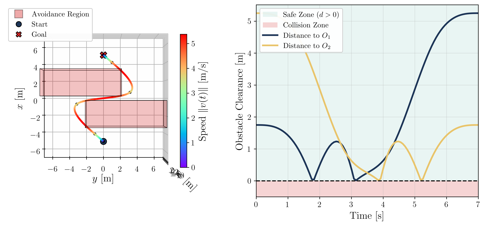
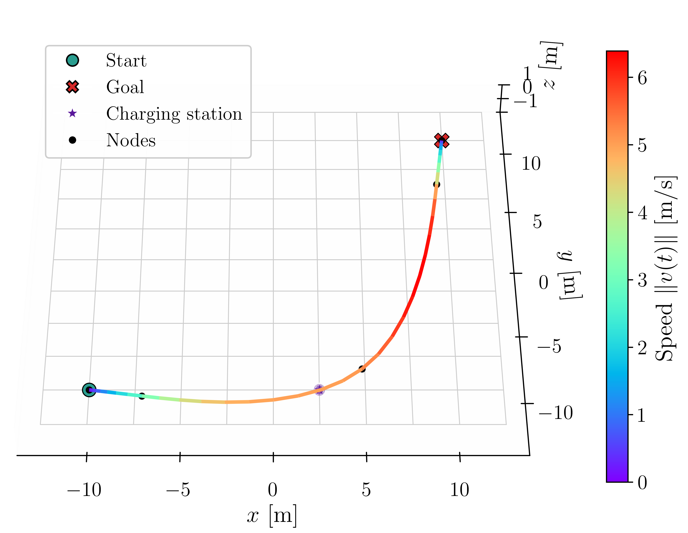

### Sequential Convex Programming for Trajectory Optimization with Continuous-Time Satisfaction of Signal Temporal Logic Specifications

This repository contains demonstrative examples of trajectory optimization under continuous-time Signal Temporal Logic (STL) specifications, solved using sequential convex programming.

#### Run locally

Python 3.11+ and C/C++ compilers are required (macOS: `xcode-select --install`).

```bash
git clone https://github.com/sametuzun781/TrajOpt_CT-STL.git
cd TrajOpt_CT-STL
python3 -m venv .venv
source .venv/bin/activate
python -m pip install -r requirements-comparators.txt
python -m ipykernel install --user --name ct-stl-icore
```

Open a `run_*.ipynb` notebook and select the `ct-stl-icore` kernel. For ICORE and
native QOCO alone, `requirements.txt` is sufficient. Native libraries build once
on first use. The original paper plotting functions use LaTeX.

Every notebook exposes the same options:

```python
SOLVER_BACKEND = "icore_cpp"  # cvxpy_qoco, qoco_native, jax_icore, icore_c, icore_cpp
DYNAMICS_AD = "forward"      # forward or reverse
DISCRETIZATION_MODE = "fast" # native CPU when certified; jax (previous fast), reference, or native
```

`fast` uses the specialized native Quadrotor RK4 when the model, dtype and CPU
match its certificate. Otherwise it uses the generic JAX sensitivity integrator.
`native` requires that certificate and a working compiler; it raises on unsupported
models, including the Double Integrator examples. `reference` retains the original
RK4 equations. All modes keep the same grid, interpolation and FP64 arithmetic.
`DYNAMICS_AD` selects the JAX/reference derivatives; native derivatives are analytic.
`CT_AD` independently selects `auto`, `forward` or `reverse` for CT-cost derivatives.
The endpoint-only shortcut is used only for a certified zero separate CT cost;
continuous constraints in augmented dynamics are still integrated.

The physical models, parameters, convex constraints, penalty weights and outer
stopping rules are retained. ICORE uses a direct chain model for the five supplied
examples. Arbitrary new convex constraints or nonzero prox-convex inner terms need
an adapter extension; use the CVXPY path when extending that model. Recreate the
dynamics and discretization factories after changing parameters. Edited Quadrotor
dynamics automatically use the JAX fallback; use `jax` for GPU or higher derivatives
of the discretizer itself. Solver tolerances apply to the consistently scaled
convex objective, with absolute tolerance `1e-8` and relative tolerance zero.

Headless runs and validation:

```bash
python run_example.py --example quad_flight --backend icore_cpp --iterations 3 --audit
python run_example.py --backend icore_cpp --audit --output runs/quad-full.json
python -m pip install pytest
python -m pytest tests -q
python -m tests.benchmark_discretization
```

Omit `--iterations` for the original iteration limit and stopping rule. Timing
columns are milliseconds; JSON totals use seconds. Build/JIT is separate from
iteration timings. Numerical comparisons and KKT audits are distinct from
nonlinear convergence. Linux/x86-64 was exercised for this migration; macOS/ARM
timings must be measured locally.

The bundled `icore/` runtime is copied unchanged from the supplied latest ICORE
archive (version `0.20.0`); examples and solver benchmark catalogs are omitted.
See `icore/LICENSE` and `icore/THIRD_PARTY_NOTICES.md` for its retained notices.
The former generated CVXPY solver directories are retained but are not needed by
the five backend choices above.

#### Main Example

**Task:** Eventually visit two dynamic waypoints and reach the end zone while always avoiding dynamic obstacles.


  


---

#### Demonstrative Examples

##### Problem 1: Always avoid obstacles



##### Problem 2: Eventually visit three waypoints


##### Problem 3: Until visiting the charging station, the speed must remain below the threshold

- **Case 1**


- **Case 2**

  
  

